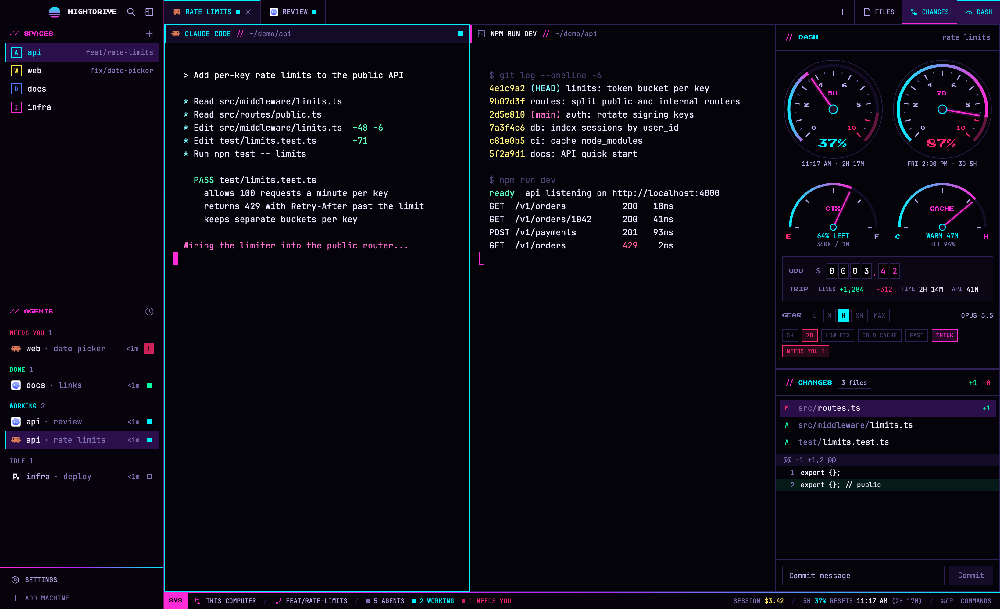

# Nightdrive for Herdr

A cyberpunk / synthwave layout for the [Herdr](https://herdr.dev) app: hot magenta and cyan on black, sharp corners everywhere, pixel-font section titles, and agent indicators that move. A working agent's square pulses and one that needs you flashes, in the sidebar and the status bar. Two side panels can be open at once, one above the other: Files, Changes, or the Dash. The Dash shows your Claude Code usage as a car's instrument cluster:
- dials for the 5-hour and 7-day windows, with a redline from 85%
- a fuel gauge for the context window left, and a temperature gauge for the prompt cache
- an odometer for the session's cost
- a gear selector for the effort level
- warning lamps

The status bar shows the focused session's cost and when your 5-hour window resets.



## Install

The simplest way is to ask the agent in your Herdr window:

> Add the Herdr layout from https://github.com/BenGlasser/herdr-nightdrive

Or do it by hand:

1. Copy into `~/.config/herdr-app/`:
   - `layouts/nightdrive.json` and `layouts/nightdrive.svg` into `layouts/`
   - `themes/nightdrive.json` into `themes/`
   - every folder in `mods/` into `mods/`
2. Check each mod: `for m in ~/.config/herdr-app/mods/nightdrive-*; do herdr-app check "$m"; done`
3. Switch to it with `herdr-app do layout.switch --name nightdrive`; `ctrl-shift-l` cycles back to your previous layout.
4. Restart Herdr once so it loads the bundled pixel font (Press Start 2P).

Your own layouts aren't touched. Deleting the files removes Nightdrive.

## Make it yours

- **Brand:** the brand bar shows a sun and `NIGHTDRIVE`. Give the `brand` block props to show your own:
  `"content": { "mod": "nightdrive-chrome", "props": { "name": "Acme", "mark": "mods/nightdrive-chrome/acme.svg" } }`.
  The mark is any image under `~/.config/herdr-app`, drawn in a 27×21 box.
- **Colors:** everything comes from `themes/nightdrive.json`, so changing a color there changes it everywhere.
- **More panels:** the tab bar adds buttons for these blocks when the layout has them:
  - `posthog-staging` and `posthog-prod`: [PostHog Feed](https://github.com/BenGlasser/herdr-posthog) panels, with a `-b` copy in the bottom stack
  - `web`: a terminal block beside the panels

## Claude Code usage

The Dash and the status bar read the JSON that Claude Code sends its status line, from `~/.claude/state/statusline/<terminal>.json`. One file per Herdr terminal, shaped like `{ "written_at": <unix seconds>, "terminal": "t3", "status": <the status-line JSON> }`. Nothing writes these files by default. Without them, the status bar leaves those numbers out and the Dash says it has no status yet.

The Dash follows the focused terminal's session, or the one that reported last when the focused terminal isn't Claude Code. It reads the files every 10 seconds, only while it's open.

To have them, make your Claude Code status line save its input there. For example, set `"statusLine": { "type": "command", "command": "sh ~/.claude/nightdrive-statusline.sh" }` in `~/.claude/settings.json`, with this as `~/.claude/nightdrive-statusline.sh`:

```sh
#!/bin/sh
# A Claude Code status line that also feeds Nightdrive's status bar and Dash.
input=$(cat)
if [ -n "$HC_TERMINAL_ID" ]; then
  dir="$HOME/.claude/state/statusline"
  mkdir -p "$dir"
  printf '{"written_at": %s, "terminal": "%s", "status": %s}\n' \
    "$(date +%s)" "$HC_TERMINAL_ID" "$input" > "$dir/.$HC_TERMINAL_ID.tmp" &&
    mv "$dir/.$HC_TERMINAL_ID.tmp" "$dir/$HC_TERMINAL_ID.json"
fi
echo "$input" | sed -n 's/.*"display_name":"\([^"]*\)".*/\1/p'
```

## What it reads and runs

- **Programs:**
  - `git`, for branches, Files' marks and the Changes list. The Changes panel's **Commit** button runs `git add -A` and `git commit`. The worktree dialogs run `git worktree add` and `git worktree remove`.
  - `sh`, for folder listings and Add machine's checks.
  - `hc machine`, for Add machine and reconnecting.
  - `open`, for the macOS Full Disk Access settings link in Add machine.
- **Files outside its own folders:**
  - `~/.claude/state/statusline/*.json`, for the status bar and the Dash
  - `~/.ssh/config` and its Includes, for Add machine's host list
  - the files you preview in Files
- **Network:** none of its own. Adding a machine connects over ssh through `hc`.

## Limits

- **Herdr's own dialogs:** confirm, prompt, toast, help, peek and the command palette can't be replaced by a layout, so they keep Herdr's rounded look.
- **No upstream updates:** the mods are modified copies of Herdr 0.1.14's built-in ones. They don't pick up later changes Herdr makes to its own mods.

## More

[`RECIPE.md`](RECIPE.md) is the full brief: every region's size, color and behavior, how it's built, and checks that prove a build works. An agent can rebuild Nightdrive from it in an empty folder.

## License

[MIT](LICENSE), except the pixel font, Press Start 2P, which keeps its own SIL Open Font License ([`mods/nightdrive-chrome/fonts/OFL.txt`](mods/nightdrive-chrome/fonts/OFL.txt)).
