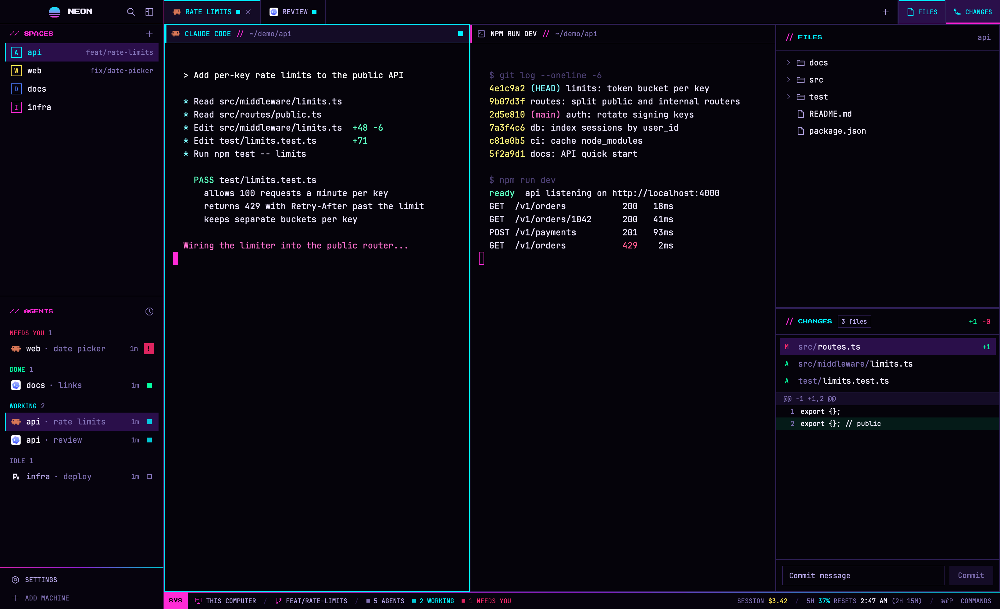

# Nightdrive

A cyberpunk / synthwave Herdr window. It's black fading into deep violet, with hot magenta (`#ff2bd6`) and cyan (`#00f0ff`) as the only loud colors. Every corner is square. Section titles are in a small pixel font, and gradient rules run from magenta to cyan along the bar edges. Spaces and agents share the left sidebar. The work area has flat full-height tabs and panes framed in thin violet lines. Its side panels can stack one above the other: Files, Changes, and a Dash that shows Claude Code's usage as a car's instrument cluster. A status bar runs along the bottom. Agents show their state as squares: working pulses, needs-you flashes, done is solid green, idle is hollow. That motion appears only in the sidebar and the status bar.



## What you see

All colors are theme names from `themes/nightdrive.json`, with their hex values. The pixel font is Press Start 2P; everything else uses JetBrains Mono.

**Window:** no system title bar. The macOS traffic lights sit at 12,16. The background is a vertical gradient from `#000000` at the top to `#1a0533`. A 1px `#ff2bd666` divider separates the sidebar from the work area. Terminal padding is 14/12.

**Theme `nightdrive`:**
- **Terminals:** background `#05030a`, text `#ece6ff`, cursor `#ff2bd6`, selection `#3d1a6e`.
- **ANSI colors:** `#0d0a17 #ff2a6d #05ffa1 #ffe14d #4d7cff #ff2bd6 #00f0ff #cfc6f2 #4b3f72 #ff5c8d #5cffc0 #fff27a #7f9cff #ff71ce #7df9ff #ffffff`.
- **Panels:**
  - surfaces: canvas `#000000`, chrome `#06030d`, surface `#0a0614`, background `#05030a`, popover `#0d0819`, raised `#140c26`, hover `#1d1038`, selected `#2a0f4a`
  - lines: border `#2e1f55`, input `#7a2cff`
  - text: foreground `#f3eeff`, muted `#b8a8ea`, dim `#8070b4`
  - accents: accent `#00f0ff`, solid `#ff2bd6` (both with black text on them)
  - status: working `#00f0ff`, blocked `#ff2a6d`, done `#05ffa1`, idle `#8070b4`, unknown `#4b3f72`

**Rule:** a 1px line of 24 equal flat segments, from `#ff2bd6` through violet to `#00f0ff`. It sits under the brand bar and the tab bar, and above the sidebar footer and the status bar.

**Left sidebar** (268px wide, `chrome`), from top to bottom:
- **Brand bar, 40px**, which drags the window:
  - a 27×21 sun: a circle cut by four horizontal bands, cyan at the top fading to magenta at the bottom
  - `NIGHTDRIVE` in the pixel font at 8px, `foreground`, 9px from the sun. A custom `name` of up to 8 letters shows at 10px.
  - at the right, two 26px square buttons with a 15px search icon and sidebar icon, `muted` with an invisible border; on hover, `hover` background with an `accent` border and icon
  - the rule along its bottom
  - row padding 14 on the left and 10 on the right; on macOS out of fullscreen the left padding is 76, to clear the traffic lights
- **Spaces** (half of the remaining height, at least 90px):
  - **Header, 31px:** `// SPACES` in the pixel font at 8px, `solid`, with a 26px `+` button.
  - **Rows,** 30px each, 8px side padding:
    - an 18px **outlined** avatar: a 1px border and the space's first letter, bold, both in the space's color
    - the space's colors are `#00f0ff`, `#ffe14d`, `#4d7cff`, `#ff2bd6`, `#05ffa1` and `#ff2a6d`. Each new space gets the least-used one.
    - a 4px square notch cut from the avatar's top-right corner
    - then the name, at most 120px
    - right-aligned at 11.5px in `dim`: `repo · branch`, plus `↑N` in `#05ffa1` and `↓N` in `#ff2a6d`. The branch is left out when it's main or master or matches the name.
  - **Active space:** `selected` background, a 2px `accent` bar on the left, and its name bold in `accent`.
  - **Worktrees:** a worktree space nests under its repo's main space at 28px, indented 22px, with a branch icon instead of an avatar.
  - **Machines:** with other machines connected, each machine's spaces sit under an uppercase machine header with a 6px square, `#05ffa1` when connected.
- **Agents** (the other half, at least 90px), with a 1px `border` line on top:
  - **Header:** `// AGENTS` in the pixel font, with a 14px sort icon (a clock for priority, layers for grouped).
  - **Group labels** are uppercase 10.5px bold in their status color: `NEEDS YOU 1` in `blocked`, `DONE` in `done`, `WORKING` in `working`, `IDLE` in `dim`.
  - **Rows,** 30px each:
    - the program's 16px icon
    - the space name, then `· tab name` in `dim`
    - at the right, the time since the last change in `dim` (`<1m`, `4m`, `2h`, `3d`), then the status
  - **Focused agent:** `selected` background with a 2px `accent` bar on the left.
  - **Sub-agents:** they sit under their parent at 26px, joined by `#7a2cff` tree lines.
- **Footer, 69px**, with the rule on top. Two 28px rows of uppercase 11px text with 14px icons: `SETTINGS` in `muted`, with a 6px `accent` dot when an update is ready, and `ADD MACHINE` in `dim`.

**Work area:**
- **Tab bar, 40px** (drags the window). It has the rule along its bottom.
  - **Tabs:** flush, full-height cells with 14px padding and a 1px `border` line on their right. Each has the program's 14px icon and the tab's name, uppercase at 11.5px and at most 170px. Working, blocked and done tabs add a still 7px square.
  - **Active tab:** `raised` background, bold `accent` text, a 2px `accent` bar along its top, and a 12px close ×.
  - **Others:** `chrome` with `muted` text.
  - **Right side:** a 40px `+` cell, then the panel buttons `FILES`, `CHANGES` and `DASH`. Each button is a 14px icon plus an uppercase 10.5px label.
    - **On:** `selected` background with `accent` text.
    - **Markers:** a 2px `accent` bar on top means open in the top slot. A 2px `solid` bar along the bottom means open in the bottom slot.
- **Panes:** the shown tab's panes sit flush (0 gap, square corners) on `background`. Each has a 1px `border` frame, or `accent` while focused. A lone pane is framed too.
  - **Pane header, 30px**, on every pane:
    - a 3px tick on the left
    - a 14px icon
    - the program's name, uppercase and bold, at most 260px
    - `//` in `solid`
    - the folder, with home shown as `~`, in `dim`
    - while hovered, 14px split-right, split-down, zoom and close buttons
  - **Focused pane:** `raised` header with an `accent` underline, an `accent` tick and an `accent` name.
  - **Other panes:** a `background` header with a `border` underline and a `solid` tick.
  - **Status:** working and done show a still 8px square; blocked shows a still `NEEDS YOU` tag.
- **Panel column, 368px** (280–900px, hidden until a panel button opens it). It holds two slots, top and bottom, split by a 1px `border` line. Each slot shows Files, Changes or the Dash. Each panel has a 42px header with `//` and the title in the pixel font in `accent`.
  - **Files:** the space's folder as a tree with 28px rows, indented 18px per level, with 14px folder and file icons. Git marks: `A` in `#05ffa1`; `M`, `D` and `U` in `#ff2a6d`. Clicking a file opens a read-only preview with syntax colors.
  - **Changes:**
    - a `N files` chip with `+N`/`−N` totals
    - the changed files (28px rows with a status letter)
    - the diff of the selected file, with added lines on `#05ffa118` and removed lines on `#ff2a6d18`
    - a commit bar: a 32px message field and a `solid` **Commit** button
  - **Dash:** the session's usage as a car's instrument cluster, on `background` with a 1px `border` frame. Its header shows the session's name (else the terminal) at the right, 12px in `dim`. Below the header, a scrolling body with 12px gaps holds, from top to bottom:
    - **Gauge layout:** the two dials, then the two half gauges, reflow with the panel's width. From 690px wide (160px for each gauge) all four sit in one line. From 350px they sit two by two, the dials above. Below 350px they stack one under another. Each line is centered, with 10px between gauges and at the sides.
    - **Two round dials, like a speedometer and tachometer:** `5H` and `7D`, the 5-hour and 7-day usage windows.
      - **Size:** each takes its share of the line: (panel width − 10 × (gauges in the line + 1)) / gauges in the line, at most 240px. That's 169px at 368px wide, two to a line. The face is a `#05030a` disc with a 1px `border` ring.
      - **Sweep:** 270°, from the bottom left, clockwise, to the bottom right.
      - **Arcs:** a 5px `raised` track, with a `#ff2a6d55` redline zone from 85% to the end. Over them, a 5px value arc in a cyan-to-magenta gradient.
      - **Ticks and numerals:** 2px major ticks every 10% (`muted`, `blocked` in the redline zone) and 1px `dim` minor ticks between them. Numerals 0–10 in the pixel font at 8px; under 190px only the even ones show.
      - **Center:** the name in the pixel font at 8px in `solid`, above the hub. The needle is a 2.5px `solid` line over a 7px `#ff2bd633` glow, on a 7px `raised` hub with a 1.5px `accent` ring.
      - **Readout:** low on the face, between the sweep's ends: `37%` in the pixel font at 16px. It's `accent` below 60%, `#ffe14d` from 60% and `blocked` from 85%.
      - **Under the face,** 10px `muted`: the reset time and time left, `11:17 AM · 2H 17M` for 5H and `FRI 2:00 PM · 3D 5H` for 7D. Once the reset time passes it reads `WINDOW RESET` and the dial reads 0.
    - **Two half gauges, like fuel and temperature:** each is as wide as a dial (at most 220px) and 0.62 of that plus 14px tall, with a 180° arc across the top. In a line of four they're centered on the dials' height.
      - **Arcs and ticks:** a 4px `raised` track and a 4px gradient value arc, with 2px `muted` ticks at the quarters.
      - **End letters,** in the pixel font at 8px.
      - **Needle:** 2px `solid` over a 6px glow, on a 5px hub.
      - **Readout:** 11px bold, with a 10px `dim` line under it.
      - **`CTX` (fuel):** the context window left, from `E` (in `blocked`, over a red zone for the first 20%) to `F`. The readout is `64% LEFT` in `accent`, or `blocked` under 20%; under it, the tokens used and the window, `360K / 1M`.
      - **`CACHE` (temperature):** how much of the prompt cache's time to live is left, from `C` (`accent`) to `H` (`solid`). The readout is `WARM 47M` or `COLD`; under it, `HIT 94%`.
    - **Odometer:** a `surface` box with a 1px `border` and 10px padding.
      - **`ODO`:** the session cost, zero-padded to `$0003.42`: six 17×26 black digit cells with a 1px `border`, 14px bold, and a 6px-wide decimal point. The cents and the point are in `solid`.
      - **`TRIP`:** below it, `LINES +1,284` in `#05ffa1`, `−312` in `#ff2a6d`, `TIME 2H 14M` and `API 41M`. Keys are 9.5px `dim`, values 11px bold.
    - **Gear:** `GEAR`, then the effort levels `L M H XH MAX` as 22px cells, 10.5px bold. The current one is filled `accent` with black text; the others are outlined in `border`, with text in `unknown`. The model's name, uppercase 11px bold in `muted`, sits at the right.
    - **Warning lamps:** 20px tags, 9.5px bold, wrapping with 6px gaps. Unlit, they're a `border` outline with `unknown` text; lit, they take their color for the border and the text, on that color at 15%.
      - `5H` and `7D` light in `blocked` from 85%.
      - `LOW CTX` lights in `blocked` under 20% left, and `COLD CACHE` in `accent` once the cache has gone cold.
      - `FAST` lights in `done` with fast mode, and `THINK` in `solid` with thinking on.
      - `NEEDS YOU n` lights in `blocked` while any agent is blocked.
    - **Labels** (`ODO`, `TRIP`, `GEAR`) are in the pixel font at 8px in `dim`. Missing values show `--`, and the odometer `----.--`.
    - **No status files:** the dash shows only its header and, at 12.5px in `muted`: "No Claude Code status yet. The dash reads ~/.claude/state/statusline/<terminal>.json, which a Claude Code status line writes for each Herdr terminal."
- **Status bar, 28px**, `chrome`, with the rule on top. Text is uppercase 10.5px in `muted`, with segments separated by `/` in `border`:
  - a `SYS` chip: `solid` with black pixel text at 7.5px
  - the machine (`THIS COMPUTER`) with a 12px monitor icon in `solid`
  - the focused space's branch
  - a 6px `dim` square with `N AGENTS`
  - `N WORKING` in `working` with a 6px square
  - `1 NEEDS YOU` (`N NEED YOU` for more) in `blocked` with a 6px square
  - at the right, for Claude Code sessions:
    - `SESSION $3.42`, the amount bold in `#ffe14d`
    - `5H 37% RESETS 2:47 AM (2H 16M)`. The percentage is bold: `accent` below 60, `#ffe14d` from 60 and `#ff2a6d` from 85. After the reset time it reads `5H WINDOW RESET`.
  - the command palette's shortcut and `COMMANDS`

**Menus and dialogs:** the terminal and tab right-click menus, the + menu, the go-to picker, the worktree dialogs, and Add machine all share one frame:
- `popover` background with a 1px `accent` border
- magenta L-brackets, 12px long and 2px thick, on the top-left and bottom-right corners like a targeting reticle
- 31px rows with 14px icons and shortcuts in `dim`, highlighted in `selected`

## How it behaves

**Agent status:**

| Status | Agents list | Spaces rail | Status bar | Tab | Pane header |
|---|---|---|---|---|---|
| working | 8px `#00f0ff` square, **pulsing** (opacity 0.18↔1, 1.1 s, ease-in-out) | `·` cyan | 6px square, **pulsing**, plus `N WORKING` | 7px square, still | 8px square, still |
| blocked | `NEEDS YOU` tag: black 10px bold on `#ff2a6d`, 18px tall. It's `!` in the priority view and on the rail. **Flashing** (opacity 0.12↔1, 420 ms, linear). | `●` red, **flashing** | 6px square, **flashing**, plus `N NEEDS YOU` | 7px square, still | `NEEDS YOU` tag, still |
| done | 8px `#05ffa1` square, still | `●` green | — | 7px square, still | 8px square, still |
| idle | 8px hollow `#8070b4` square | `·` dim | — | nothing | nothing |

A done agent becomes idle once someone looks at it. A focused done agent stays in DONE until the focus leaves it. All motion is native (`.loop`) and stops when nothing is shown. No timers redraw the window.

**Sidebar:**
- **Spaces:**
  - **Click** selects a space.
  - **Drag** a space onto another to reorder it within its machine. The row fades to half opacity and a 2px `accent` line shows where it'll land.
  - **Right-click** opens the space menu: Rename, New/Open/Remove worktree, Close.
  - The header's `+` makes a new space.
- **Agents:**
  - **Click** focuses an agent's pane. A sub-agent row focuses it, or peeks at it when it has no pane.
  - **Hover** an agent to show a pin button. Pinned agents go first.
  - **Group headers** fold and unfold.
  - **The sort icon** opens a framed menu: Priority (needs you, done, working, idle; within a status, most recent first) or Grouped by space.
- **Brand bar:**
  - **Search** opens the go-to picker: a 640px popup 40px from the top, filtering tabs, spaces and agents.
  - **The sidebar button** folds the sidebar to a rail of 76px on macOS (44px elsewhere), and a second click brings back the old width. Dragging the sidebar below 160px also gives the rail.
  - **The rail:** spaces become numbered 32px cells with a status glyph, and agents become numbered rows. A `»` at the bottom unfolds it.
- **Footer:** `SETTINGS` opens Settings; `ADD MACHINE` opens the Add machine dialog.

**Tabs:**
- **Click** a tab to show it.
- **Drag** a tab onto another to move it.
- **Double-click** to rename it.
- **Right-click** for Rename, New tab and Close.
- **Scroll the wheel** over the bar to step through the tabs.
- **The `+` menu** starts a terminal or any installed agent. Keys 1–9 pick the first nine agents. It also makes a new space, a new worktree or opens one.

**Panels:**
- **Click** `FILES`, `CHANGES` or `DASH` to open that panel in the top slot; click it again to close it. **⌥-click** opens or closes it in the bottom slot instead.
- **Picking another panel** for a slot replaces what's there. The same panel can be open in both slots.
- **The column** hides when both slots are empty.
- **Per space:** each space remembers its own panels, and switching spaces restores them. A space that never had panels opens with them closed.

**Panes:** click a pane to focus it. The header's buttons split, zoom or close the pane. Right-clicking in a terminal opens the Nightdrive terminal menu: Split right, Split down, Zoom, where right-clicks go, and Close pane.

**Status bar:** checks the Claude Code status files every 10 seconds, and clicking `COMMANDS` opens the command palette.

**Dash:**
- **Which session:** the focused terminal's. When that terminal has no status file, the dash shows the session that reported most recently. The 5-hour and 7-day windows belong to the account, so they come from whichever session reported them last.
- **Updates:** it reads the status files every 10 seconds, but only while it shows, and catches up as soon as it's opened. A read redraws it only when something it shows has changed, so the countdowns move once a minute.
- **Motion:** none. Needles move to their new value on the next read, and the lamps light without flashing; flashing stays in the sidebar and the status bar.
- **Size:** the gauges rearrange and resize as the panel is dragged: one line of four when it's wide, two by two in between, stacked when it's narrow. They jump to the new arrangement without animating. When the slot is too short for everything, the body scrolls; stacked, that's most of the time.

## Built from

**Files.** The folder is laid out like `~/.config/herdr-app`:
- `layouts/nightdrive.json` and `layouts/nightdrive.svg` (the settings screen's picture of the layout)
- `themes/nightdrive.json`
- 14 mods in `mods/`

**Layout tree** (`layouts/nightdrive.json`, cloned from Herdr's `main`). The root is a `row` with:
- `"theme": "nightdrive"`, `"ui_font": "JetBrains Mono"`, `"titlebar": "none"`, `"traffic_lights": [12, 16]`
- `"terminal_padding": [14, 12]`, `"terminal_menu": "nightdrive-menu"`, `"preview": "layouts/nightdrive.svg"`
- `"background": {"gradient": ["#000000", "#1a0533"], "angle": 180}`, `"divider": {"width": 1, "color": "#ff2bd666"}`

```
root (row)
├─ sidebar (column, 268px, min 44, max 480, background chrome, resizable false)
│  ├─ brand (block, 40px, window_drag)          nightdrive-chrome
│  ├─ sidebar-lists (column)
│  │  ├─ spaces (block, weight 1, min 90)       nightdrive-spaces
│  │  └─ agents (block, weight 1, min 90)       nightdrive-agents
│  └─ sidebar-footer (block, 69px)              nightdrive-chrome {footer: true}
└─ work (column, resizable false)
   ├─ tabs (block, 40px, window_drag)           nightdrive-tabs
   ├─ work-body (row, padding 0, gap 0)
   │  ├─ main (block)  {tab: "active", pane: {radius 0, gap 0, lone true, background "background",
   │  │                  border {1, border}, focus {1, accent},
   │  │                  header {mod nightdrive-pane, height 30, position top, reveal always}}}
   │  └─ panel (column, 368px, min 280, max 900, hidden, divider {1, border})
   │     ├─ panel-top (stack, active files): files nightdrive-files, changes nightdrive-changes,
   │     │                                    dash nightdrive-dash {block: "dash"}
   │     └─ panel-bottom (stack, active files-b, hidden): files-b nightdrive-files, changes-b nightdrive-changes,
   │                                                      dash-b nightdrive-dash {block: "dash-b"}
   └─ status (block, 28px)                       nightdrive-status
```

**Mods.** All but `nightdrive-dash` are clones of Herdr 0.1.14's own mods (`mod.clone`), restyled. Every `mod.json` has `"place": "none"`, so installing them docks nothing.

| Mod | Cloned from | Role |
|---|---|---|
| `nightdrive-chrome` | workspace-chrome | Brand bar, or the footer with `{footer: true}`. Props `name` and `mark` (an image path) replace `NIGHTDRIVE` and the sun. Home of the shared parts: `nightdrive.js`, 31 icons, `mark.svg`, `fonts/` |
| `nightdrive-spaces` | spaces | Spaces list and rail |
| `nightdrive-agents` | agents | Agents list, rail and its own sort menu (opened as itself with `{sortMenu: true}`) |
| `nightdrive-tabs` | tabs | Tab bar, the + menu opener and the two-slot panel buttons |
| `nightdrive-pane` | pane | Pane header |
| `nightdrive-status` | workspace-status | Status bar (rewritten) |
| `nightdrive-files`, `nightdrive-changes` | files, changes | Panels |
| `nightdrive-dash` | (new) | The usage dash. Prop `block` is its own block id (`dash` or `dash-b`), so it can tell when it's hidden and stop reading. Its `mod.json` is `{"place": "none", "title": "Dash"}`. |
| `nightdrive-menu` | menu | Terminal, tab and space menus. Its `mod.json` sets `"overlay": {"frame": "none"}`. |
| `nightdrive-new-menu` | new-menu | The + menu |
| `nightdrive-picker` | picker | Go-to picker (`mod.json` overlay: popup at top, offset 40, 640 wide, 0.8 high, frame none) |
| `nightdrive-worktree` | worktree | New, open and remove worktree dialogs |
| `nightdrive-machine-add` | machine-add | Add machine (dialog, 560 wide, frame none) |

**`nightdrive.js`**, the shared look, is in `nightdrive-chrome` and copied into each other mod. It provides:
- `DISPLAY` (the pixel font)
- `MARK` (the six avatar colors)
- `statusBlock(t, status, size, animated)`
- `needsYou(t, compact, flashing)`
- `flash(el)`
- `rule(height)`
- `title(t, text)`
- `notch(color, size, corner)`
- `reticle(t, 12)`

Every overlay is opened with `frame: "none"` and draws `.relative().bg(popover).border_1().border_color(accent).children(reticle(t))`.

**The dash's drawing:**
- **Shapes:** each arc, ring, tick set and needle is a gpui-kit path: `PathBuilder.stroke(width)` or `PathBuilder.fill()`, then `move_to`, `line_to`, `arc_to(rx, ry, 0, large, sweep, x, y)`, `close` and `build`.
- **Painting:** each path goes through `window.paint_path(path, color)` as an absolutely placed, full-size child of the gauge's `relative()` box. The value arcs pass `Background.linear_gradient(90, accent, solid)` in place of a color.
- **Text:** numerals and readouts are absolutely placed divs, centered on a point.
- **Angles:** computed with `cos` and `sin`, clockwise from 3 o'clock, since screen y points down.
- **Fields read:**
  - from the status file's `status`: `rate_limits.five_hour` and `rate_limits.seven_day` (each `{used_percentage, resets_at}`), `context_window` (`context_window_size`, `used_percentage`, `remaining_percentage`), `prompt_cache` (`warm`, `ttl`, `expires_at`, `hit_ratio`), `cost` (`total_cost_usd`, `total_lines_added`, `total_lines_removed`, `total_duration_ms`, `total_api_duration_ms`), `effort.level`, `model.display_name`, `fast_mode`, `thinking.enabled`, `session_name` and `session_id`
  - from the file itself: `written_at`, to find the newest

**Herdr functions:**
- `spaces`, `agents`, `terminals`, `panes`, `focused`, `layout`, `theme`, `settings`, `keys`, `window`, `updates`, `machines`, `props` and `home`
- `shared` and `setShared` with these keys: `space.colors`, `agents.sort`, `sidebar.width`, `sidebar.collapsed`, `new-menu.agents`, and `workspace.panels` (read only)
- `localStorage`: `panels` in nightdrive-tabs, the per-space `{top, bottom, web}`
- `setAgentOrder`, `openOverlay`, `closeOverlay`, `watchFolder`, `readTextFile` and `knownAgents`
- Commands:
  - spaces: `space.select`, `space.move`, `space.new`, `space.close`
  - tabs: `tab.select`, `tab.move`, `tab.rename`, `tab.close`, `tab.new`, `tab.next`, `tab.prev`
  - panes and terminals: `pane.focus`, `pane.split`, `pane.zoom`, `pane.close`, `terminal.pin`, `terminal.peek`, `terminal.park`, `terminal.right_click`
  - layout: `layout.select`, `layout.show`, `layout.hide`, `layout.resize`
  - app: `mod.open`, `app.settings`, `app.palette`, `app.help`, `app.theme`

**Programs:**
- `git`, for the branch, ahead/behind, worktree detection, Files marks and the Changes list and diff. Read commands run with `--no-optional-locks`.
  - Changes' Commit runs `git add -A` and `git commit -m`.
  - The worktree dialogs run `git worktree add` and `git worktree remove`.
- `sh`, for folder listings and the Add machine checks.
- `hc machine ls`, `hc machine add` and `hc machine rm`.
- `open`, for the macOS Full Disk Access settings link in Add machine.
- PowerShell on Windows only.

**Files read outside the mods:**
- `~/.claude/state/statusline/<terminal>.json`, in the status bar and the dash
- `~/.ssh/config` and its Includes, in Add machine

**Art:**
- 41 angular 24×24 icons (31 in `nightdrive-chrome`, 5 in `nightdrive-pane`, 4 in `nightdrive-files`, and the dash button's gauge in `nightdrive-dash`): stroke 1.75, square caps, miter joins, `currentColor`. The tab bar's Windows window buttons are Herdr's originals.
- `mark.svg`, the sun: a circle of radius 9.5 in a 27×21 box, with a vertical gradient from `#00f0ff` to `#ff2bd6`, clipped to bands at y 0–12.6, 13.8–16, 17.2–18.8 and 19.8–21
- Press Start 2P (`mods/nightdrive-chrome/fonts/`, SIL OFL)
- `layouts/nightdrive.svg`

## Watch out

- **Editing shipped mods:** Herdr restores its own mods on every start. Clone each one (`herdr-app do mod.clone '{"name":"tabs","as":"nightdrive-tabs"}'`), then edit the clone, and point the layout and every `openOverlay` / `mod.open` at the clones' names.
- **Shared helpers:** mods can't import from another mod's folder; `../nightdrive-chrome/nightdrive.js` fails with "resolves outside the application directory". Keep `nightdrive.js` in `nightdrive-chrome` and copy it into each mod after every change.
- **Gradients:** `.bg()` takes flat colors only, and `image()` keeps its aspect ratio. So the rule is 24 flat segments rather than a stretched gradient image. Gradients live only in the layout background and in SVGs.
- **Herdr's own overlays:** they can't be restyled. Confirm, prompt, toast, help, peek and the command palette keep rounded corners.
  - Overlays the app opens by name need `"overlay": {"frame": "none"}` in their `mod.json`: the terminal menu through `terminal_menu`, and the picker and Add machine through `mod.open`.
  - Every `openOverlay` the mods make passes `frame: "none"`.
- **Animation:** only the agents list, the spaces rail's blocked glyph and the status bar animate; tabs, pane headers, the picker and the dash stay still on purpose. Use `.loop("opacity", …)` and never a timer, because every redraw repaints the whole window.
- **Window drag:** the brand bar and tab bar drag the window. Their buttons must stop the mouse-down (`cx.stop_propagation()`), or the drag eats the press.
- **Panel ids:** the panel buttons find nodes by id: `panel`, `panel-top`, `panel-bottom`, `files`, `changes`, `dash`, `files-b`, `changes-b`, `dash-b`. Every panel needs a `-b` twin in the bottom stack.
  - `FILES` and `CHANGES` follow `shared("workspace.panels")`, which Herdr's welcome sets; without it, both show. `DASH` shows whenever the layout has a `dash` node.
  - Nodes `posthog-staging` / `posthog-prod` (the PostHog Feed mod, with `-b` twins) or a `web` terminal block add `STAGING`, `PROD` or `WEB` buttons. This layout has none of them.
- **Theme:** `themes/nightdrive.json` is named like the layout, which makes it this layout's own theme: Settings offers it only here.
- **Font:** Herdr loads a mod's `fonts/` at start, so restart Herdr once after installing.
- **Status bar files:** the cost and 5-hour window come from files something else writes: Claude Code's status line JSON saved as `{written_at, terminal, status}` under `~/.claude/state/statusline/<HC_TERMINAL_ID>.json`. Without those files the bar leaves them out.
  - It reads the files of every `claude-code` agent plus the focused terminal, local terminals only.
  - The cost is the focused terminal's; the 5-hour window comes from the newest file.
  - The dash reads the same files the same way.
- **Dash drawing:**
  - `paint_path` is on the global `window`, and mods that import Herdr's `window()` hide that name. The dash calls `globalThis.window.paint_path`.
  - There's no rotation, so every needle and tick is a line between two points worked out with trig.
  - Keep each gauge a `relative()` box with a fixed width and height. The paths use its local pixels.
- **Token counts:** `context_window.total_input_tokens` and `total_output_tokens` are the last turn's, not the session's, so they jump between reads. The dash leaves them out and takes the tokens used from `context_window_size × used_percentage`.
- **New mods dock themselves:** the first time Herdr sees a mod folder, it docks a copy into the shown layout unless `mod.json` says `"place": "none"`. Write `mod.json` before `main.js`, or a stray copy lands in the layout and has to be removed from the layout file.
- **Spaces order:** nightdrive-spaces issues `space.move` itself to keep worktree spaces right under their repo's space.
- **No upstream updates:** these are 0.1.14 clones and won't follow Herdr's later changes to its own mods.
- **Leftovers:** `shared("sidebar.collapsed")` is written but nothing reads it. The menu's theme list (graphite, ink, moss, atom one dark) doesn't include nightdrive.
- **Limits:**
  - sidebar 44–480px, rail below 160px
  - panel column 280–900px
  - Files lists 500 entries per folder and 5,000 in all, and previews up to 400,000 characters
  - Changes shows up to 1,000 files and 1,500 diff lines

## Done when

- `herdr-app check` passes for all 14 mods, and `herdr-app do layout.switch --name nightdrive` gives a `herdr-app status` with layout `nightdrive` and no errors.
- The window has no system title bar. It shows the black-to-violet background, the 268px sidebar with the sun and `NIGHTDRIVE`, the 40px tab bar and the 28px status bar. All corners are square, and `// SPACES`, `// AGENTS` and `SYS` are in the pixel font.
- In a terminal, `printf '\033]7501;state=working:app=claude-code\007'`:
  - pulses an 8px cyan square in the agents list and a 6px one in the status bar
  - shows a still square on its tab and pane header
- `state=blocked` puts the agent under `NEEDS YOU` with a flashing red tag. The status bar's `1 NEEDS YOU` square flashes too, while the pane header's tag stays still.
- `state=done` on an agent you aren't looking at gives a still green square under `DONE`. `state=idle` gives a hollow square under `IDLE`.
- Clicking `FILES` opens Files on top with an `accent` marker. ⌥-clicking `CHANGES` opens Changes below with a magenta marker. Both show at once.
- Switching to another space and back restores that space's panels.
- The sidebar button folds the sidebar to the rail and back. Spaces show as numbered cells, and a blocked space's dot flashes.
- Right-clicking a terminal, the `+` cell, and the brand bar's search all open framed menus: an `accent` border with magenta corner brackets.
- With a status file for the focused Claude Code terminal, the status bar shows `SESSION $x.xx / 5H n% RESETS h:mm AM (xH yyM)`.
- Clicking `DASH` opens the dash in the top slot with an `accent` marker, and ⌥-clicking it opens it below. Without status files, it shows the "No Claude Code status yet" message.
- Dragging the panel from about 330px to 760px wide stacks the four gauges, then puts them two by two, then in one line.
- With a status file whose `rate_limits.seven_day.used_percentage` is 87:
  - the 7D needle sits in the red zone, the readout `87%` is red and the `7D` lamp is lit
  - the 5H dial, the CTX and CACHE gauges, the odometer and the gear match the file's values
  - setting `prompt_cache.warm` to false makes the CACHE gauge read `COLD` and lights `COLD CACHE` within 10 seconds
- The brand block with props `{"name": "Acme", "mark": "<image path>"}` shows that name and image instead.
